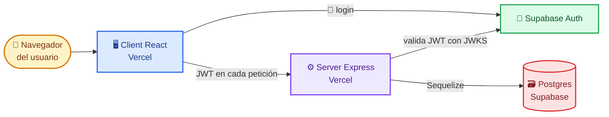
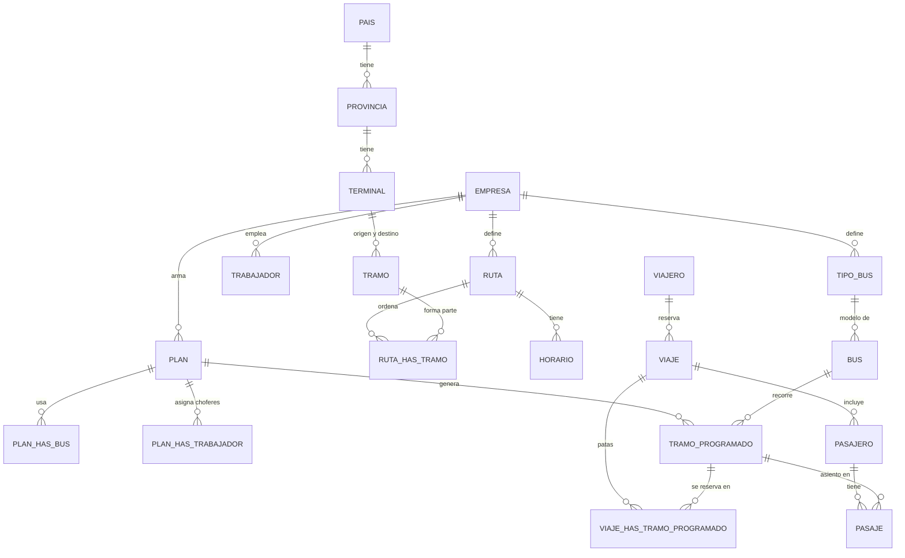
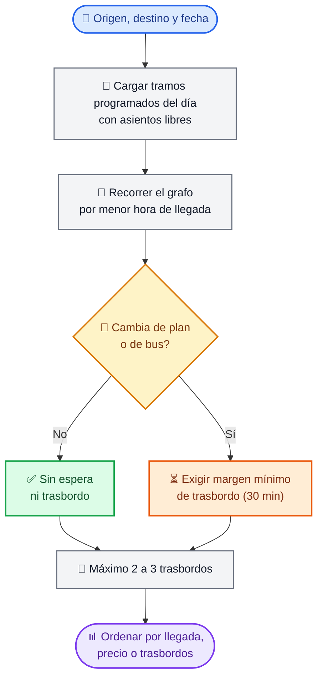
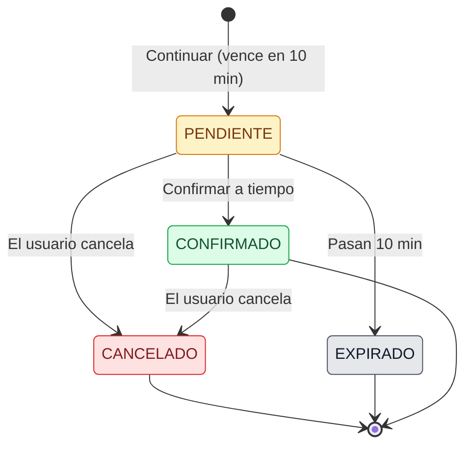

# 🚌 Reserbus

**Reserva de pasajes de bus con varias empresas, al estilo redBus.**

Sistema de reserva de pasajes de bus con **varias empresas de transporte**. El viajero busca un origen y un destino, y Reserbus le arma el recorrido combinando tramos de distintas empresas si hace falta. Los usuarios de prueba son ficticios y no hay pasarela de pago.

| 🔗 | Servicio | URL |
|---|---|---|
| 🖥️ | **Client** | https://cdx-reserbus.vercel.app |
| ⚙️ | **Server (API)** | https://cdx-reserbus-server.vercel.app (solo responde al client) |

---

## 🚌 Qué hace

1. Cada **empresa** define sus **rutas**, que son secuencias ordenadas de **tramos** (terminal origen y terminal destino).
2. La empresa arma **planes**: una ruta, un horario, buses y choferes.
3. El viajero busca, por ejemplo, *Lima a Puno*. La app **no muestra planes completos**, sino las **secciones de los planes que calzan** con la búsqueda, y puede **combinar empresas distintas** con trasbordos.
4. El viajero elige **asientos concretos** y reserva. Esa reserva se llama **viaje**.

Ejemplo de conexión entre empresas:

| Plan | Empresa | Recorrido |
|---|---|---|
| 🔵 Plan A | Andes | TA → TB → TC |
| 🟠 Plan B | Altiplano | TB → TD → TE |

Para ir de **TA a TD**, el resultado es TA → TB con el Plan A y luego TB → TD con el Plan B.

---

## 🧰 Stack

| Capa | Tecnología |
|---|---|
| 🎨 Front | React 19, TypeScript, Vite, Tailwind CSS 4, React Router 7, Formik y Yup, Axios, date-fns |
| ⚙️ Back | Node.js, Express 5, Sequelize |
| 🗃️ Base de datos | PostgreSQL en Supabase (schema `reserbus`) |
| 🔑 Autenticación | Supabase Auth (correo y contraseña, y Google), tokens validados con JWKS usando `jose` |
| ☁️ Despliegue | Vercel (dos proyectos: client y server) |

---

## 🏗️ Arquitectura



Puntos clave:

- El correo y la contraseña viven en `auth.users` de Supabase. La base del proyecto solo guarda el **perfil** enlazado por `auth_id`.
- El rol de una cuenta **no se guarda en el token**: se deduce de en qué tabla de perfil existe su `auth_id`.
- El server rechaza cualquier petición que no venga del client.

---

## 👥 Roles y permisos

| Rol | Tabla de perfil | Qué puede hacer |
|---|---|---|
| 🛡️ `ADMIN` | `administrador` | Gestiona empresas, usuarios, países, provincias y servicios. No tiene relación con ninguna empresa. |
| 🏢 `EMPRESA` | `trabajador` (tipo `ADMINISTRATIVO`) | Gestiona la flota, tipos de asiento, tarifas, rutas, planes y tramos programados de **su** empresa. |
| 🧑‍✈️ Chofer | `trabajador` (tipo `CHOFER`) | Se asigna a planes. No tiene panel propio. |
| 🧳 `VIAJERO` | `viajero` | Busca, reserva, confirma y cancela sus viajes. |

Las búsquedas y los catálogos de ubicación (países, provincias, terminales, tramos) son de lectura pública para el client; todo lo demás exige token.

---

## 🗄️ Modelo de datos

El DDL completo está en [`Reserbus - DDL.sql`](./Reserbus%20-%20DDL.sql).

### 🗺️ Vista general



### 📋 Tablas por grupo

📍 **Ubicación y red** (globales, compartidas entre empresas para permitir conexiones)

| Tabla | Para qué sirve |
|---|---|
| 🌎 `pais` | Nombre y `desfase_utc_min` (Perú = -300) para convertir UTC a hora local. |
| 🏙️ `provincia` | Pertenece a un país. Permite filtrar "terminales de Arequipa". |
| 🚏 `terminal` | Punto físico. El distrito va dentro de `direccion`, no tiene tabla propia. |
| ➖ `tramo` | Segmento dirigido de terminal origen a terminal destino. |

👤 **Actores** (cada uno enlazado a Supabase Auth por `auth_id`)

| Tabla | Para qué sirve |
|---|---|
| `administrador` | Sysadmin de la plataforma. |
| `empresa` | Empresa de buses. `activa` permite desactivarla sin borrarla. |
| `trabajador` | Pertenece a una empresa. Tipo `CHOFER` o `ADMINISTRATIVO`. |
| `viajero` | Cliente que reserva. |

🚍 **Flota y tarifas** (por empresa)

| Tabla | Para qué sirve |
|---|---|
| `tipo_bus` | Modelo de bus: `filas`, `asientos_por_fila` y total calculado. |
| `tipo_asiento` | Categoría de asiento (ej. "Cama") con `tarifa_extra`. |
| `tipo_bus_has_tipo_asiento` | Qué rangos de filas son de qué tipo de asiento. |
| `tarifa` | `monto_base` por tipo de bus y tramo. |
| `bus` | Bus físico con `placa`. `activo` permite darlo de baja sin perder historial. |
| `servicio`, `bus_has_servicio` | Servicios del bus (wifi, baño, etc.). |

🛣️ **Rutas y planes**

| Tabla | Para qué sirve |
|---|---|
| `ruta` | Ruta de una empresa. |
| `ruta_has_tramo` | Tramos de la ruta en orden (`posicion`) con `duracion_min`. |
| `horario` | Hora de salida (UTC) del primer tramo de una ruta. |
| `plan` | Ruta + horario de una empresa. `activo` controla si genera tramos programados. |
| `plan_has_bus`, `plan_has_trabajador` | Buses y choferes asignados al plan. |

🎟️ **Operación y reservas**

| Tabla | Para qué sirve |
|---|---|
| ⭐ `tramo_programado` | **Un bus recorriendo un tramo de un plan en una fecha concreta.** Es la arista de la búsqueda, la unidad que se reserva y el lugar de los tiempos estimados y reales. |
| `viaje` | La reserva. Estados: 🟡 `PENDIENTE`, 🟢 `CONFIRMADO`, 🔴 `CANCELADO`, ⚫ `EXPIRADO`. |
| `pasajero` | Persona que viaja. El mismo documento no se repite dentro de un viaje. |
| `viaje_has_tramo_programado` | Las "patas" del viaje, ordenadas. Una conexión tiene varias. |
| `pasaje` | Asiento de un pasajero en un tramo programado: `fila`, `columna`, `codigo_asiento`, `precio`, `vigente`. |

### 💰 Cómo se calcula el precio

```
precio del asiento = tarifa.monto_base (tipo de bus, tramo)  +  tipo_asiento.tarifa_extra
```

Un viaje con varios tramos suma el precio de cada uno, y el valor se **congela** en `pasaje.precio` al reservar.

### 🛡️ Qué garantiza la base de datos

| Regla | Mecanismo |
|---|---|
| Bus, tipo de bus, ruta, plan, tipo de asiento y chofer son siempre de la misma empresa | FKs compuestas con `id_empresa` |
| Solo los trabajadores `CHOFER` se asignan a un plan | Restricción en `plan_has_trabajador` |
| Un tramo programado usa un bus del plan y un tramo de la ruta del plan | FKs compuestas |
| Un asiento no se vende dos veces mientras esté vigente | Índice único parcial |
| Liberar asientos al cancelar o expirar | Trigger que pone `pasaje.vigente = FALSE` |

---

## 🧠 Cómo funciona por dentro

### 🔎 Búsqueda de viajes

`GET /api/busqueda` modela el problema como un grafo con tiempo: los **nodos** son terminales y las **aristas** son tramos programados de la fecha con asientos libres.



Parámetros principales:

| Parámetro | Descripción |
|---|---|
| `origen`, `destino` | Id de terminal. También existen `origen_provincia` y `destino_provincia`. |
| `fecha` | Día **local** del terminal de origen (`YYYY-MM-DD`). |
| `pasajeros` | Cantidad de asientos que se necesitan (por defecto 1). |
| `max_trasbordos` | Máximo de trasbordos (por defecto 2). |
| `trasbordo_min` | Margen mínimo en minutos (por defecto 30). |
| `orden` | `llegada`, `precio` o `trasbordos`. |

### ⏱️ Reserva con hold de 10 minutos



| Estado | Significado |
|---|---|
| 🟡 `PENDIENTE` | Asientos retenidos, esperando confirmación |
| 🟢 `CONFIRMADO` | Reserva firme |
| 🔴 `CANCELADO` | Cancelada por el viajero, asientos liberados |
| ⚫ `EXPIRADO` | Se venció el hold de 10 minutos |

1. Al pulsar **Continuar** se crea el viaje `PENDIENTE` con sus pasajeros, patas y pasajes. El índice único impide que otra persona tome el mismo asiento.
2. Al **confirmar**, el server verifica que siga `PENDIENTE` y que `vence_en` no haya pasado.
3. Al **cancelar** o **expirar**, un trigger libera los asientos.
4. `reserbus.expirar_viajes()` marca como `EXPIRADO` los pendientes vencidos. Se llama antes de consultar disponibilidad o reservar.

### 💺 Disponibilidad de asientos

Un asiento está ocupado en un tramo programado si existe un `pasaje` **vigente** con esa `(fila, columna)`. Como la ocupación es por tramo, el mismo asiento se reutiliza entre tramos distintos: alguien baja en una parada y otra persona sube.

Los asientos no tienen tabla. El código es la fila más la letra de la columna, por ejemplo `12A`. Con 4 asientos por fila las columnas son `A B | C D`.

### 📅 Generación de tramos programados

`services/generacion.js` genera, para cada plan **activo**, cada bus asignado y cada día del horizonte (90 días por defecto), un tramo programado por cada tramo de la ruta.

- La hora de cada tramo es la hora de salida más la suma de las duraciones anteriores (no hay esperas en paradas).
- Es idempotente: no duplica registros existentes.
- No crea tramos que ya salieron.

---

## 📁 Estructura del repositorio

```
Reserbus/
├── Reserbus - DDL.sql          DDL completo (schema reserbus)
├── client/                     Front React + TypeScript
│   ├── public/                 Logos e ilustraciones
│   └── src/
│       ├── app/                Rutas principales (App.tsx)
│       ├── components/         Header y componentes de UI compartidos
│       └── features/
│           ├── account/        Perfil del viajero
│           ├── admin/          Panel del administrador
│           ├── auth/           Contexto de sesión, modales, rutas protegidas
│           ├── booking/        Reserva, resumen, mis viajes
│           ├── search/         Home y resultados de búsqueda
│           └── static/         Secciones informativas y 404
└── server/                     API Express
    ├── index.js                Punto de entrada, CORS y bloqueo de acceso directo
    ├── middleware/auth.js      Validación de JWT, perfil y roles
    ├── models/                 Modelos Sequelize (uno por tabla)
    ├── routes/                 Endpoints agrupados por recurso
    ├── services/               Lógica: búsqueda, viajes, generación, usuarios
    ├── lib/                    Utilidades (errores, SQL, cliente Supabase)
    ├── scripts/                seed, crear-admin, token
    └── pruebas/                Prueba de punta a punta y archivo .http
```

---

## 💻 Instalación local

### ✅ Requisitos

- Node.js 20 o superior
- Un proyecto de Supabase con el DDL ya ejecutado

### 🪜 Pasos

**1. Crear la base de datos**

Abre el SQL Editor de Supabase y ejecuta `Reserbus - DDL.sql`. El script empieza con `DROP SCHEMA IF EXISTS reserbus CASCADE`, así que se puede volver a correr para reiniciar todo.

**2. Configurar el server**

```bash
cd server
npm install
# crea server/.env con las variables de la sección siguiente
npm run seed        # datos de prueba
npm start           # http://localhost:3001
```

**3. Configurar el client**

```bash
cd client
npm install
# crea client/.env con las variables de la sección siguiente
npm run dev         # http://localhost:3000
```

El client usa un proxy de Vite que redirige `/api` hacia `http://localhost:3001`, así que en local no necesitas definir `VITE_API_URL`.

### 🧪 Usuarios de prueba (creados por el seed)

Todos usan la contraseña `Reserbus123!`.

| Rol | Correo |
|---|---|
| 🛡️ Administrador | `admin@example.com` |
| 🏢 Empresa Andes | `andes.admin@example.com` |
| 🏢 Empresa Altiplano | `altiplano.admin@example.com` |
| 🧑‍✈️ Chofer | `chofer.andes@example.com` |
| 🧳 Viajero | `viajero@example.com` |
| 🧳 Viajero 2 | `viajero2@example.com` |

---

## 🔐 Variables de entorno

### ⚙️ Server (`server/.env`)

| Variable | Descripción |
|---|---|
| `DB_HOST`, `DB_PORT`, `DB_NAME`, `DB_USER`, `DB_PASSWORD` | Conexión a Postgres de Supabase. |
| `DB_SSL` | Ponla en `false` solo si usas una base local sin SSL. |
| `SUPABASE_URL` | URL del proyecto de Supabase. |
| `SUPABASE_PUBLISHABLE_KEY` | Llave pública (se usa en `scripts/token.js` y en las pruebas). |
| `SUPABASE_SECRET_KEY` | Llave secreta para administrar usuarios. **Solo en el server.** |
| `SUPABASE_JWKS_URL` | Llaves públicas para validar tokens. Normalmente `https://TU-PROYECTO.supabase.co/auth/v1/.well-known/jwks.json`. |
| `CLIENT_ORIGINS` | Dominios permitidos separados por coma. En producción: `https://cdx-reserbus.vercel.app`. |
| `PORT` | Puerto local (por defecto 3001). |
| `TRASBORDO_MIN_MIN` | Margen mínimo de trasbordo en minutos (por defecto 30). |
| `BASE_URL` | Solo para `npm run prueba`, si el server no está en `localhost:3001`. |

### 🖥️ Client (`client/.env`)

| Variable | Descripción |
|---|---|
| `VITE_SUPABASE_URL` | URL del proyecto de Supabase. |
| `VITE_SUPABASE_PUBLISHABLE_KEY` | Llave pública de Supabase. |
| `VITE_API_URL` | URL del server en producción. En local se deja vacía. |

Los archivos `.env` no se suben al repositorio.

---

## 📜 Scripts disponibles

Todos se ejecutan desde `server/`, salvo los del client.

| Comando | Qué hace |
|---|---|
| `npm start` | Levanta la API con nodemon. |
| `npm run seed` | Crea usuarios en Supabase Auth, perfiles y datos de prueba. Se puede repetir. |
| `npm run prueba` | Prueba de punta a punta: login, búsqueda con trasbordo entre empresas, reserva con hold, doble venta, confirmar, cancelar, expiración y permisos. Requiere el server corriendo y el seed ejecutado. |
| `node scripts/crear-admin.js correo clave nombres apellidos` | Crea el primer administrador. |
| `node scripts/token.js correo clave` | Imprime un access token para probar la API con curl o Postman. |
| `npm run dev` (client) | Servidor de desarrollo de Vite. |
| `npm run build` (client) | Revisa tipos y genera el build de producción. |

---

## 📐 Reglas de diseño

Decisiones acordadas que conviene respetar al modificar el proyecto.

| Regla | Detalle |
|---|---|
| Sin esperas en paradas | La llegada a un terminal es también la salida del siguiente tramo. |
| Tiempos en UTC | `TIMESTAMPTZ` siempre. La hora local se obtiene con `pais.desfase_utc_min`. |
| Estimado y real | `tramo_programado` guarda `salida_estimada`, `llegada_estimada`, `salida_real` y `llegada_real`. |
| Buses de 1 piso | Pasillo al medio y el mismo número de asientos a cada lado. |
| Sin tabla de asientos | El asiento es `(fila, columna)`. |
| Precios por empresa | `tipo_asiento` y `tarifa` pertenecen a cada empresa. |
| Cobro por tipo de bus | Varios buses pueden compartir ruta y horario con distinto plan y precio. |
| Hold de 10 minutos | Mientras el usuario completa la reserva. |
| Precio congelado | Se guarda en `pasaje.precio` al reservar. |